

  

    

---

### 🚀 Featured Projects

<a href="https://github.com/ballerina-platform/lsp4intellij#gh-dark-mode-only">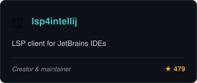</a><a href="https://github.com/ballerina-platform/lsp4intellij#gh-light-mode-only">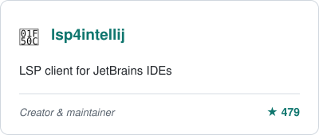</a>
<a href="https://github.com/NipunaRanasinghe/awesome-ai-agents#gh-dark-mode-only">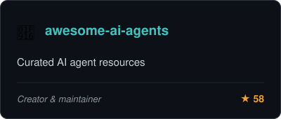</a><a href="https://github.com/NipunaRanasinghe/awesome-ai-agents#gh-light-mode-only">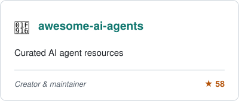</a>
 
<a href="https://github.com/ballerina-platform/ballerina-lang/tree/master/misc/debug-adapter#gh-dark-mode-only">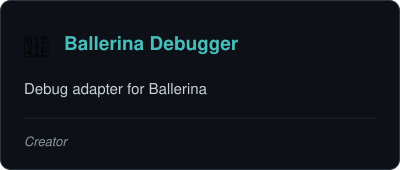</a><a href="https://github.com/ballerina-platform/ballerina-lang/tree/master/misc/debug-adapter#gh-light-mode-only">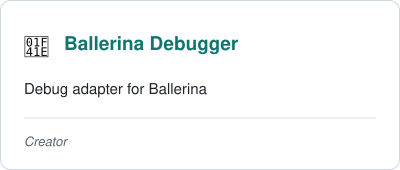</a>
<a href="https://github.com/ballerina-platform/ballerina-vscode#gh-dark-mode-only">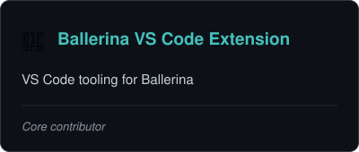</a><a href="https://github.com/ballerina-platform/ballerina-vscode#gh-light-mode-only">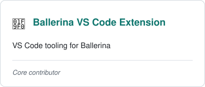</a>
 
<a href="https://github.com/ballerina-platform/ballerina-lang/tree/master/misc/semver-checker#gh-dark-mode-only">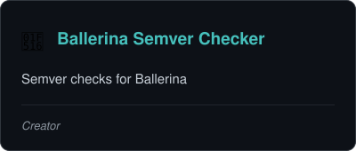</a><a href="https://github.com/ballerina-platform/ballerina-lang/tree/master/misc/semver-checker#gh-light-mode-only">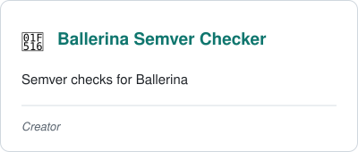</a>
<a href="https://github.com/ballerina-platform/plugin-intellij#gh-dark-mode-only">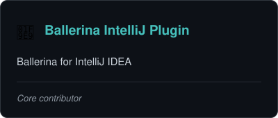</a><a href="https://github.com/ballerina-platform/plugin-intellij#gh-light-mode-only">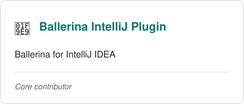</a>

---

### 🛠️ Tech Stack

  
  

---

### 📊 GitHub Analytics

  
  

  

---

### 🧾 Certifications

---

### 🌐 Connect with Me

---

### ✍️ Latest Blog Posts

